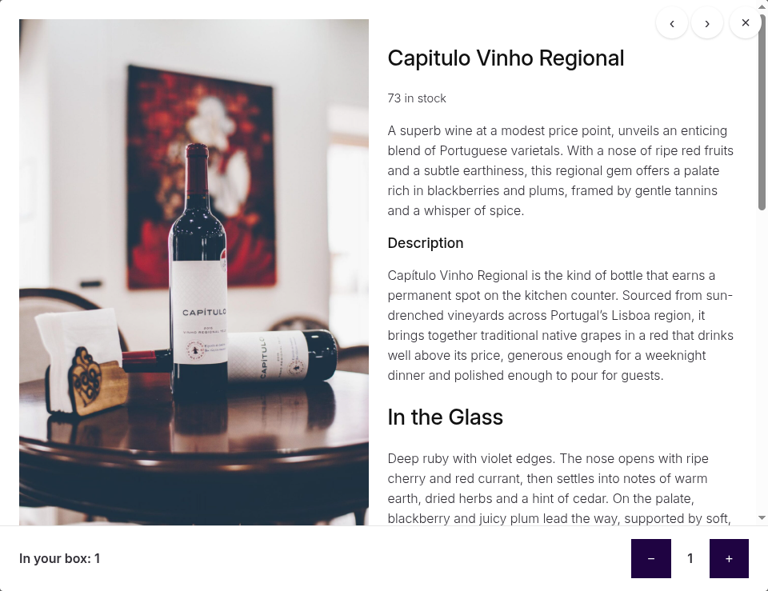

# WC Mix and Match - Quickview

### What's This?

Mini-extension for [WooCommerce Mix and Match](https://woocommerce.com/products/woocommerce-mix-and-match-products/) that opens a child item's product details in a pop-up when shoppers click the magnifier button in the corner of its image, or its title. The pop-up has a button to add the product to the container, a quantity stepper, and previous/next buttons to page through the products.

It's built on the Interactivity API and the Mix and Match container store (`@wc-mix-and-match/container`): the modal reads each child item's state from the store and changes quantities with its actions, so it doesn't depend on how the add to cart form is rendered. It works in forms loaded with ajax, such as editing a subscription, but not in the admin, where the store isn't loaded. The script needs no build step and no React.



### Customizing the button text

The buttons say "Add" and "Remove", and the footer says "Selected: 2", so they suit any kind of container. The remove button is shown for checkbox selections, the stepper for quantities.

Each Mix and Match product has "Quick view add button text" and "Quick view remove button text" fields in its Mix and Match product data, ex: "Add to bundle".

Or use the filters:

```php
add_filter( 'wc_mnm_quick_view_add_to_box_text', function( $text, $container ) {
	return __( 'Add to bundle', 'your-textdomain' );
}, 10, 2 );

add_filter( 'wc_mnm_quick_view_remove_from_box_text', function( $text, $container ) {
	return __( 'Remove from bundle', 'your-textdomain' );
}, 10, 2 );

// All other strings, ex: "Selected: %d".
add_filter( 'wc_mnm_quick_view_i18n', function( $i18n ) {
	$i18n['inBox'] = __( 'In your bundle: %d', 'your-textdomain' );
	return $i18n;
} );
```

For screen readers, the add, remove and stepper buttons name the product, ex: "Add Capitulo Vinho Regional". The `buttonLabel` string, `%1$s %2$s`, puts the button text and the product title together, so it can be reordered in translations or with the `wc_mnm_quick_view_i18n` filter.

### Other filters and hooks

* `wc_mnm_has_quick_view` - return false to turn the quick view off, gets the container product when known.
* `wc_mnm_quick_view_template_args` - change the data passed to the content template, gets the child item.
* `wc_mnm_quick_view_preload_all` - return false to stop loading every child item's details once the page is idle. They then load on the first hover or focus of a child item, in one request per container.
* `wc_mnm_quick_view_before_summary` / `wc_mnm_quick_view_after_summary` - add to the product details, get the child item and the container.
* The product details come from `templates/single-product/mnm/quick-view-content.php`, which can be overridden in your theme at `yourtheme/woocommerce/single-product/mnm/quick-view-content.php`.

### Working with the quick view from JavaScript

The quick view's store is `wc-mnm-quickview`. Its state includes `isOpen`, `containerId`, `productId` and `loaded`.

The product details are HTML from the server, so the Interactivity API doesn't process directives in them. To work with them, watch `state.loaded`. It gets a new `{ containerId, productId }` object each time a product's details are put in the modal, after the HTML is in the page.

Print an element for your store:

```php
add_action( 'wp_footer', function() {
	echo '<div hidden data-wp-interactive="my-plugin" data-wp-watch="callbacks.onQuickViewLoaded"></div>';
} );
```

Then, in a script module that depends on `@wc-mnm-quickview/quick-view`:

```js
import { store } from '@wordpress/interactivity';

const { state: quickView } = store( 'wc-mnm-quickview' );

store( 'my-plugin', {
	callbacks: {
		onQuickViewLoaded() {
			const loaded = quickView.loaded;

			if ( ! loaded ) {
				return;
			}

			const content = document.querySelector( '.wc-mnm-quick-view__content' );
			// Set up loaded.productId's details in content.
		},
	},
} );
```

### Development

The script is a native ES module, `assets/js/frontend/quick-view.js`, registered as the `@wc-mnm-quickview/quick-view` script module. Its store namespace is `wc-mnm-quickview`. The styles are written in `assets/scss/frontend/quick-view.scss` and compiled into `assets/css/`, which isn't committed. Run `npm install`, then `npm run dev` to build the CSS and the minified and RTL copies, or `npm run watch` to rebuild on save. The minified files are used when present and `SCRIPT_DEBUG` is off.

### Important

1. This is provided as is and does not receive priority support.
2. Please test thoroughly before using in production.
3. Requires Mix and Match 3.0.0-beta.1+, WooCommerce 8.0+ and WordPress 6.5+.
